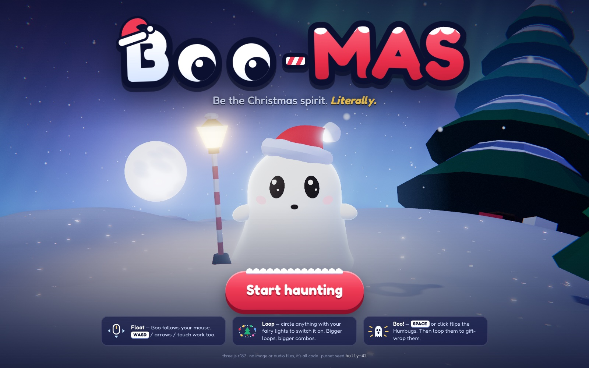
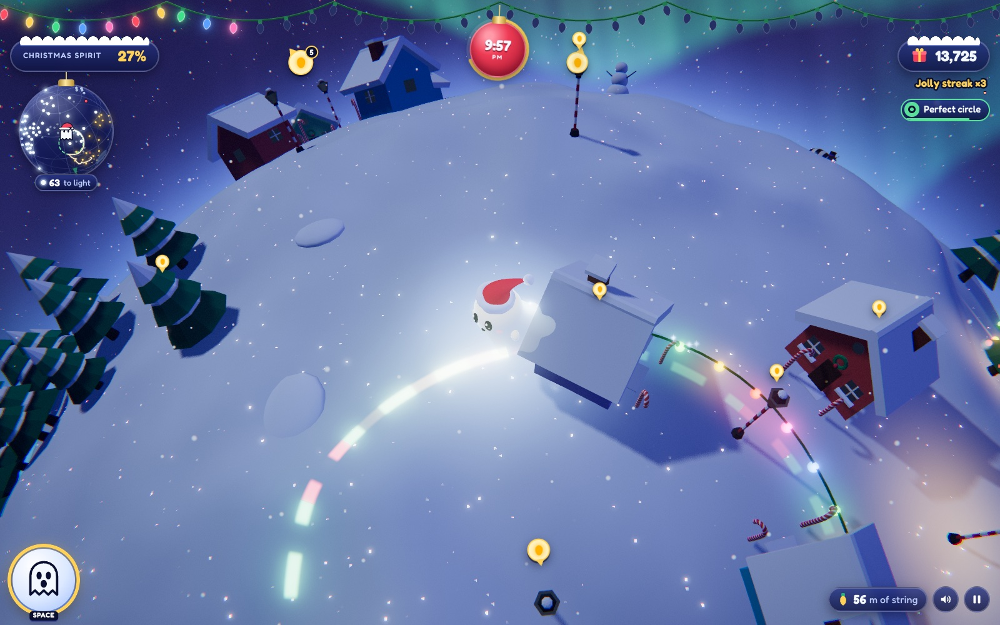
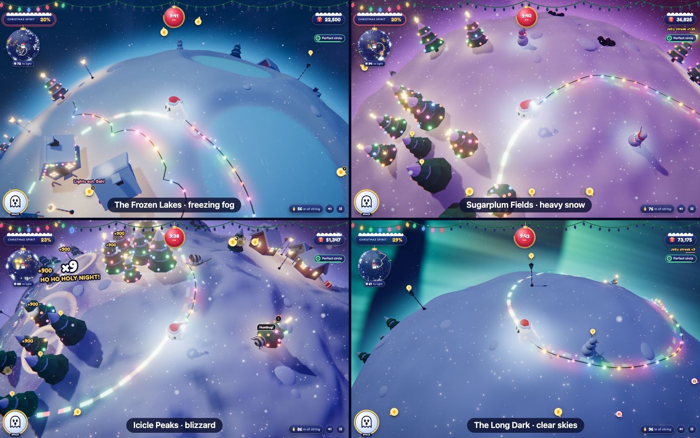
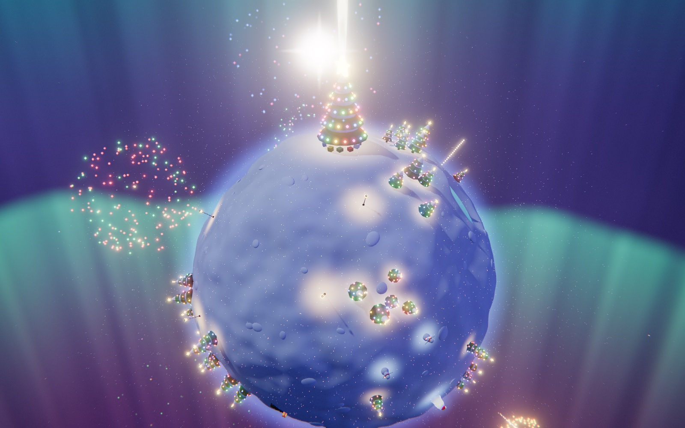

# Boo-mas 👻🎄

**Be the Christmas spirit. Literally.**

A tiny three.js game about a small ghost in a Santa hat. The lights have gone out on a snow-globe-sized
planet, Humbugs are loose, and midnight is coming. Drag a string of fairy lights behind you and draw
**loops** around trees, cottages, lamp posts and snowmen to switch them on.






## Play

**Play it in your browser: <https://robinduckett.github.io/boo-mas/>**

To run it yourself: it's plain ES modules with no build step. Serve the folder with anything:

```sh
npm start                       # or: python3 -m http.server 8000
# then open http://localhost:8000
```

To play on a phone, put it on the same Wi-Fi and run `npm run start:lan`; it prints the address to
open. (That makes the game folder readable by anything on your network while it runs.)

(Opening `index.html` straight from disk won't work — browsers block module imports from `file://`.)

## How to play

| | |
|---|---|
| **Float** | Boo sits in the middle of the screen and heads for the mouse: the further the pointer is from the middle, the faster he goes. `WASD` / arrow keys and gamepads work too. On a touch screen there is a thumb-stick bottom-left, or drag anywhere else to steer toward your finger; tap (with either thumb) to BOO. |
| **Loop** | Close a loop with your string of lights and everything inside lights up. Bigger loops → bigger multiplier. Quick consecutive loops build a *jolly streak*. |
| **BOO!** | `Space` or click. Flips nearby Humbugs onto their backs. Loop a Humbug to gift-wrap it. |
| **Bonuses** | Loop a Humbug while it is still on its feet and that's a *live catch*: ×2, and it wraps up as a golden present. Two or more Humbugs in one loop is a pair, a trio or a swarm. A streak, a live catch, a pack and a perfect circle each multiply the whole loop — and they stack. |
| **Presents** | Every present you collect makes your string of lights longer; a golden one, twice as much. |
| **Power-ups** | One at a time, something falls out of the sky. A **shooting star** makes your string enormous for ten seconds. A **wreath** is yours to keep until you set it off (`E`, or its button): it paints the biggest circle your string can close, round as much as it can find, and holds you to it while you steer round. While you carry one, the number on its button is how much the ring would catch from where you are, and it pulses when that is a good haul. A **candy cane** is a sugar rush. |
| **The globe** | The bauble under the spirit meter is the whole planet. Pale dots are still dark, gold ones are lit, and Boo is always in the middle — so the direction of a dot from the middle is the direction to steer. Dimmer dots are round the far side. `G`, or a click or tap on it, makes it bigger. |
| **Pointers** | A few markers at the edge of the screen point at what you can't see: a Humbug chewing (the ring shows how long the lights have left), a power-up, a present, and the nearest dark things, rolled together with a count when they lie the same way. Stragglers — the last one or two in a group, and the last few of the night — get a pip of their own. |
| **Your hat** | A Humbug that bumps you knocks your hat off. No hat, no lights — and if you dawdle, the Humbug will put it on and run. |
| **Night after night** | Every star you earn carries over: you keep part of the string you gained, and fly a little faster, on the next night. You'll want both: the planet is bigger each night (for the first six), and it's somewhere new. |
| **Biomes** | After Pine Hollow come the Frozen Lakes, Icicle Peaks, Sugarplum Fields and the Long Dark, in an order that depends on the planet's seed. |
| **Weather** | It bends the rules a little. A **blizzard**'s gusts push you about. **Clear skies** drop power-ups more often. In **heavy snow** the Humbugs wade slowly. In **freezing fog** you can't see far, so trust the globe. |

Light the whole planet before midnight to save Christmas — three minutes on night one, a little
longer as the planet grows — then move on to a harder night.

`E` use a wreath · `Esc` pause · `M` mute · `G` big globe · `H` hide the HUD · add `?seed=anything` to the URL to share a planet.

### Poking at it

| URL flag | |
|---|---|
| `?seed=holly-42` | pick the planet (same seed → same planet) |
| `?night=3` | start on a later, harder night (a bigger planet, another biome, other weather) |
| `?autopilot` | Boo plays itself (badly) — handy for watching things happen |
| `?manual` | don't start the frame loop; drive it yourself with `boo.step(seconds)` from the console. This is how the game was tested headlessly: load the page, step the simulation, take a screenshot. |

## Things you might enjoy if you read source code

- **No image or audio assets.** Geometry, textures, shaders, music and sound effects are all generated
  in code. The only binary files are the UI font and three.js itself.
- **The loop mechanic lives on a sphere.** The trail is a polyline of unit vectors. A loop closes when a
  new great-circle arc crosses an old one (`arcIntersect` in `src/utils.js`), or passes close enough to
  snap. The enclosed region is flattened with a *gnomonic* projection — which maps great circles to
  straight lines, so an ordinary 2D point-in-polygon test stays exact — and triangulated for the
  glitter fill.
- **The minimap is not a second render.** Everything on it is a point on the unit sphere, so
  `src/minimap.js` just projects those points orthographically onto a 2D canvas, in Boo's own frame
  (screen-right, up-the-screen, out-of-the-planet). Boo is at the centre, and a great circle through
  him projects to a straight line through the centre — so the bearing of any dot is the direction to
  steer, even for the far side, which you see through the glass.
- **The wreath does spherical geometry.** A circle of angular radius *a* on a sphere of radius R has
  circumference 2πR·sin *a*, so the ring that spends a string of length L has a = asin(L / 2πR)
  (the game leaves a little slack for wobbles). `src/wreath.js` tries two dozen such circles through
  Boo and keeps the one with the most left to light inside it.
- **The planet's size is not a constant.** Each night's world sets the radius (30 units on night
  one, 42 by night six), so nothing caches it; distances are world units and get divided by the
  radius where an angle is needed. A biome is a handful of numbers in `src/config.js`: how tall and
  how busy the terrain noise is, what gets planted, and a palette for snow, ice, fog, lights and aurora.
- **Wind on a sphere has to go round something** (you can't comb a hairy ball flat), so a blizzard
  blows in circles about an axis square to where the night begins: full strength there, dying away
  toward the axis's two ends. The snow is carried round the same axis in its vertex shader.
- **Screen-edge pointers know about the horizon.** Something round the back of the planet still
  projects to a point on screen — through the planet — which is meaningless. Those are pointed at
  along the tangent you would steer along instead.
- **Adaptive music.** `src/audio.js` is a small WebAudio sequencer playing an original music-box carol.
  It begins sparse and minor; as the planet's spirit rises it gains bass, arpeggios, sleigh bells and
  tempo, and at 50% it modulates to the parallel major on a bar line. The chimes you hear when things
  light up are quantised to whatever key the music is currently in.
- **It's a ghost.** It has no collision at all. When something solid is in front of it you see it
  *through* the thing (a second pass of the same mesh with the depth test inverted). It casts no
  shadow — but its hat does.
- **Humbugs** are beetles striped like the mint. Sorry.
- **Rendering** uses three.js r187's built-in HDR output pipeline (`outputBufferType` +
  `renderer.setEffects`): the scene renders to a multisampled half-float target, bloom only picks up
  values above 1.0 (so only things that are actually *lit* glow), then ACES tone-mapping.
- **Light pools** on the snow are additive discs drawn straight after the terrain with no depth test,
  so they hug the hills without z-fighting and everything else draws over them.
- The planet is procedural and seeded: terrain from Perlin noise on a cube-sphere, villages, groves
  and ponds placed by rejection sampling.
- Open the dev tools: there is a small `boo` console API (`boo.light(0.5)`, `boo.bug()`,
  `boo.pickup('wreath')`, `boo.autopilot()`, `boo.night(3)`).

## Layout

```
index.html        page + UI markup
css/style.css     UI
src/main.js       renderer, camera, rules, scoring, the flow of a night
src/world.js      the planet and everything standing on it
src/ghost.js      Boo (body shader, face, hat physics)
src/garland.js    the string of lights + loop detection
src/humbugs.js    the Humbugs, and the snowmen who throw snowballs at them
src/presents.js   presents
src/pickups.js    power-ups lying in the snow: shooting star, wreath, candy cane
src/wreath.js     the wreath's guide ring, and the pull that holds Boo to it
src/minimap.js    the globe: the whole planet, projected onto a 2D canvas
src/fx.js         particles, shockwaves, fireworks
src/sky.js        aurora, stars, moon, atmosphere, snowfall
src/audio.js      synthesised music + sound effects
src/ui.js         HUD / menus / screen-edge pointers
src/input.js      keyboard, pointer, touch, gamepad
vendor/three      three.js r187 (unmodified) + the two post-processing addons used
```

`npm run build` is an optional esbuild bundling step that writes a single minified file to `dist/`.
It has not been exercised — the game is developed and tested as unbundled modules.

## Credits & licences

- [three.js](https://threejs.org) — MIT (see `vendor/three/LICENSE`)
- [Fredoka](https://fonts.google.com/specimen/Fredoka) typeface — SIL Open Font License (see `assets/fonts/OFL.txt`)
